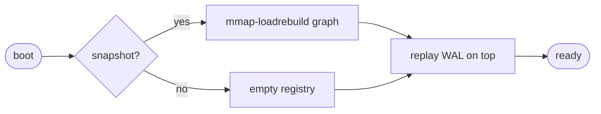
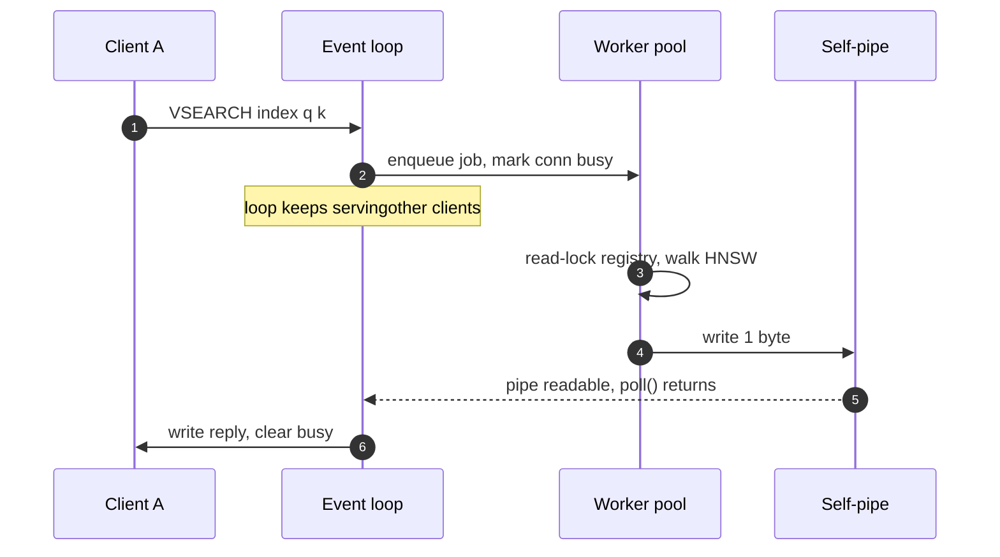

# Engram: Building a Vector Memory Engine in Rust

An associative vector-memory engine, handwritten in Rust from poll() up — event loop, SIMD kernels, an HNSW index, a crash-safe log, and a worker-pool reactor. Zero dependencies but libc.

Author: Priyam Ghosh
Published: June 16, 2026
Canonical: https://prigoistic.me/blog/engram.html
Keywords: Rust, vector search, HNSW, SIMD, Redis protocol

redis remembers keys.
engram remembers meaning.

[view source →](https://github.com/Prigoistic/engram) [read the design](https://prigoistic.me/blog/engram.html#architecture)

**~5.3k** lines of rust

**1** dependency · libc

**123** tests passing

**8.8×** simd over scalar

**1.00** recall@10

**<0.6ms** p99 ping under load

## 00 / motivation — Why build this?

Every agent framework eventually bolts on a “memory” — a vector store you write embeddings to and query by similarity. In production you’d reach for `usearch`, `FAISS`, or `pgvector`, and you should. So why hand-roll one?

Because the interesting research surface is the *retrieval primitive itself* — associative recall, energy-based memory, decay and consolidation — and off-the-shelf databases won’t let you touch it. **engram** is a substrate I fully control: a real, wire-compatible memory engine where the similarity core is mine to replace. The byproduct is a tour through the systems stack — multiplexing, SIMD, graph indexes, durability, concurrency — each built by hand and measured, not imported.

It speaks **RESP2**, the Redis wire protocol, so `redis-cli`, `redis-benchmark`, and every Redis client library talk to it unchanged.

## 01 / architecture — One loop, a handful of descriptors

The whole engine is driven by readiness on a few file descriptors through a single `poll()`. Here is the stack — and the idea that holds it together is that *everything*, including cross-thread search completions, enters through that same loop.

event loop · i/o multiplexer

one `poll()` over kqueue (macOS) / epoll (Linux) — watches the listener, every client socket, and a self-pipe

server

accept · per-connection read buffers · in-order reply tracking

resp2 codec + command dispatch

parse `argv`, arity-check, route to a handler — key-value commands run inline

vector engine

simd kernels (neon/avx2/scalar) · hnsw graph index · registry behind an `RwLock`

search worker pool

VSEARCH runs off the loop; results return through the self-pipe

persistence

crc-framed fsync’d wal · compacting snapshot loaded via `mmap`

### Everything is a file descriptor

The multiplexer exposes two operations — `subscribe(fd)` and `poll()` — and over the engine’s lifetime exactly three kinds of fd are ever registered. That set *is* the architecture.

| subscribed fd | readiness means |
| --- | --- |
| listener socket | a new client is waiting → `accept()` |
| client socket | bytes arrived → parse & dispatch commands |
| self-pipe | a worker finished a search → write its reply |

## 02 / hot path — SIMD distance kernels

Similarity search spends nearly all its time in one inner loop: the dot product / squared-L2 between a query and stored vectors. So that loop is hand-written with SIMD intrinsics and chosen at runtime — **NEON** on Apple Silicon, **AVX2 + FMA** on x86-64, scalar elsewhere. The scalar version stays as the oracle the SIMD paths are tested against.

```
#[cfg(target_arch = "aarch64")]
pub fn dot(a: &[f32], b: &[f32]) -> f32 {
    // SAFETY: NEON is baseline on AArch64, always available.
    unsafe { dot_neon(a, b) }      // 4 x 128-bit FMA accumulators / iter
}

#[cfg(target_arch = "x86_64")]
pub fn dot(a: &[f32], b: &[f32]) -> f32 {
    if is_x86_feature_detected!("avx2") && is_x86_feature_detected!("fma") {
        unsafe { dot_avx2(a, b) }  // guarded by runtime detection
    } else { dot_scalar(a, b) }
}
```

scalar

47.9 ms

neon

5.4 ms

100,000 × 768-dim dot products. **8.85× faster**, ~28 GFLOP/s — bit-comparable to the scalar reference across every vector length, including the remainder/tail paths.

## 03 / the index — HNSW, by hand

Exact nearest-neighbour search is a linear scan — fine as a correctness oracle, too slow at scale. The approximate index is a from-scratch **Hierarchical Navigable Small World** graph: a stack of layers where upper layers are sparse “express lanes” and the bottom holds everyone. A query greedily descends from the top entry point, then runs a breadth-bounded search at the base.


Diagram labels: L2 entry L1 L0 k-nn result

greedy descent through the layers, then a breadth-bounded search at L0

The implementation follows Malkov & Yashunin (2018): the `search_layer` routine, the neighbour-selection heuristic (keep a candidate only if it’s closer to the base than to any already-chosen neighbour, with kept-pruned backfill), and bidirectional linking with degree pruning. Deletes are tombstones; `VSAVE` compacts them away.

Measured **recall@10 = 1.00** against the exhaustive scan on a held-out query set — the graph returns exactly what brute force would, far faster.

## 04 / durability — Write-ahead log + snapshot

Persistence follows the shape of Redis’ AOF + RDB. Every mutation is appended to a **write-ahead log** and flushed; a periodic **snapshot** captures live state so the log can be truncated. The log is the source of truth — a crash loses nothing committed.

### Each record is self-describing

crc-32
u32

length
u32

payload · op + length-prefixed fields

On replay, records are read until one is short or fails its checksum — the exact signature of a write torn by a crash. Everything up to that point is durable and is replayed; the torn tail is discarded. The snapshot is written to a temp file and `rename`d into place (atomic), then loaded back through a read-only `mmap`.



Validated the brutal way: write data, `kill -9` the process mid-flight (no clean shutdown), restart — WAL replay reconstructs the full index, dead keys stay dead, and a post-snapshot crash recovers from snapshot + tail.

## 05 / concurrency — Non-blocking search

The loop is single-threaded — perfect for key-value ops that finish in nanoseconds. But an HNSW walk over millions of vectors takes milliseconds, long enough to stall every other client. So `VSEARCH` is the one command pushed off the loop, onto a pool of worker threads that read the registry under a shared lock.

The elegant part: there is no second event system. A worker writes one byte to a **self-pipe**, whose read end is subscribed to the *same* multiplexer. The loop wakes for “search done” exactly the way it wakes for “socket readable.”



A connection with a search in flight is marked *busy* so its later commands don’t overtake the pending reply — per-connection ordering is preserved while every other connection runs free. A monotonic connection id guards against a worker’s result landing on a different client that reused the same fd.

1 client

681 q/s

8 clients

3,859 q/s

**5.7× parallel speedup**, and during the storm `PING` stayed at **0.06 ms median / 0.57 ms max** — the event loop never head-of-line-blocks behind a search.

## 06 / honesty — What I’d do differently

Being honest about the gaps is the point — these are the difference between “correct and fast enough to demo” and “saturates a NIC at p99.”

- One global `RwLock` over the registry — a single insert stalls all readers. Per-index locks or an epoch / arc-swap read path would fix it.
- The WAL `fsync`s on every write. Real systems group-commit, or offer an `everysec` durability tier.
- `search_layer` clones the neighbour list each hop and allocates a fresh visited-set per query — a reused, versioned visited array removes both.
- Vectors are raw `f32` with no quantization (PQ/SQ would cut memory 4–32×), and the live store is heap-resident — serving reads straight from a persistent `mmap` is the natural next step.
- Single-node, single-reactor: no sharding, no write-backpressure handling.

None are conceptually hard — they’re the next tier. Knowing where your own system breaks is the actual engineering.

## 07 / run it — Try it yourself

```
cargo run -- --dir ./data        # start with persistence on :6380

redis-cli -p 6380 VNEW mem 4 METRIC l2     # create a 4-dim index
redis-cli -p 6380 VSEARCH mem <query> 10   # 10 nearest keys + distances
redis-cli -p 6380 VSAVE                    # snapshot + truncate the WAL
```

Commands: `VNEW · VADD · VSEARCH · VDEL · VINFO · VSAVE`, alongside the classic `GET / SET / DEL / INCR / …` key-value set. Vectors travel on the wire as packed little-endian `f32` bulk strings.

built in rust · [github.com/Prigoistic/engram](https://github.com/Prigoistic/engram) · apache-2.0
